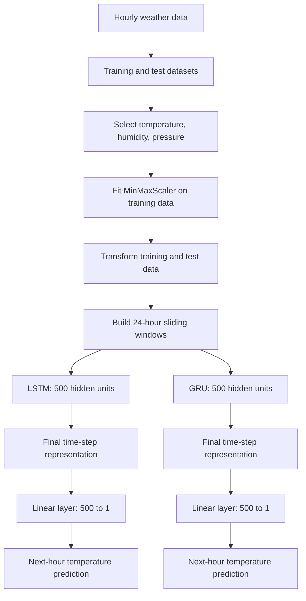

# 🌦️ Hourly Temperature Forecasting with LSTM & GRU

**A multivariate time-series forecasting project that uses recurrent neural networks to predict the next hour's temperature from the previous 24 hours of weather observations.**

This project explores two gated sequence-learning architectures—**Long Short-Term Memory (LSTM)** and **Gated Recurrent Unit (GRU)**—using PyTorch. Temperature is the prediction target, while humidity and atmospheric pressure provide additional context to the models.

> **Project focus:** Time-series forecasting · Deep Learning · Recurrent Neural Networks · PyTorch

---

## Project at a glance

| Component | Implementation |
|---|---|
| Problem type | Multivariate, one-step-ahead regression |
| Forecast target | Temperature at the next time step |
| Input features | Temperature, humidity, pressure |
| Look-back window | 24 consecutive hourly observations |
| Training rows in notebook output | 35,008 |
| Test rows in notebook output | 8,753 |
| Model families | LSTM and GRU |
| Hidden size in saved checkpoints | 500 units |
| Deep-learning framework | PyTorch |
| Feature scaling | scikit-learn `MinMaxScaler` |
| Available model artifacts | `weather_lstm.pth`, `weather_gru.pth` |

The supplied data files contain 35,008 training rows and 8,753 test rows. With a 24-step sliding window, the notebook constructs **34,984 training sequences** and **8,729 test sequences**. Each input sequence has the shape `(24, 3)`: 24 time steps and 3 weather features.

## Why this project matters

Weather observations are temporal: the current temperature is related not only to the latest reading, but also to recent changes in humidity, pressure, and temperature. This project turns that sequence of observations into a supervised learning problem and investigates how two popular gated recurrent architectures can learn those temporal relationships.

It also provides a practical comparison point for model architecture, preprocessing, sequence construction, optimization, checkpointing, and inference in PyTorch.

## Forecasting workflow



### 1. Data preparation

The notebook reads separate training and test CSV files. It removes the `datetime` column from the training feature table and uses the three numeric weather variables:

- **Temperature** — the target variable and a historical input feature.
- **Humidity** — an additional atmospheric input signal.
- **Pressure** — an additional atmospheric input signal.

The code assumes the rows are already arranged in chronological hourly order. The `datetime` value is not fed directly into either neural network.

### 2. Feature scaling

A `MinMaxScaler` maps each feature to the range `[0, 1]`. It is fitted on the training data and then reused to transform the test data. This keeps the test set out of the scaler-fitting step and ensures both datasets use the same learned scaling parameters.

### 3. Sequence generation

A sliding-window function converts the scaled rows into input/target pairs. For each sample:

- **Input (`X`):** the previous 24 observations, each containing temperature, humidity, and pressure.
- **Target (`y`):** the temperature value immediately after that 24-observation window.

Conceptually, the forecasting task is:

\[
[X_{t-23}, X_{t-22}, \ldots, X_t] \longrightarrow T_{t+1}
\]

where each `X` contains the three weather features and `T` is temperature.

### 4. Model learning

Both recurrent architectures process the sequence and pass the representation from the final time step to a fully connected layer. The output layer produces one scalar: the next-step temperature prediction in the scaled target space.

### 5. Prediction

The prediction helper switches the model to evaluation mode and uses `torch.no_grad()` to disable gradient tracking during inference. The notebook selects Apple Metal Performance Shaders (`mps`) when available and otherwise falls back to CPU.

---

## Model architectures

### LSTM — Long Short-Term Memory

The notebook defines a `WeatherLSTM` with a single PyTorch LSTM layer followed by a linear regression head:

```python
self.lstm = nn.LSTM(
    input_size=3,
    hidden_size=500,
    batch_first=True
)
self.fc = nn.Linear(500, 1)
```

The LSTM maintains a hidden state and a cell state. Its input, forget, and output gates regulate what information is written, retained, and exposed over the sequence. This gated memory mechanism was introduced to help recurrent networks learn dependencies across longer time intervals.

### GRU — Gated Recurrent Unit

The supplied `weather_gru.pth` checkpoint contains GRU-layer parameters and a linear output head. Its parameter shapes indicate a single recurrent layer with **3 input features**, **500 hidden units**, and a **500-to-1 output layer**.

A GRU uses reset and update gates to control information flow. Compared with an LSTM of the same input and hidden dimensions, this saved GRU checkpoint contains fewer trainable parameters.

### Checkpoint-level architecture comparison

The following parameter totals are calculated from the tensor shapes in the two supplied `.pth` state dictionaries, including the final linear layer.

| Model | Recurrent layer | Hidden size | Total parameters in checkpoint |
|---|---|---:|---:|
| LSTM | 1 layer, 4 gate blocks | 500 | **1,010,501** |
| GRU | 1 layer, 3 gate blocks | 500 | **758,001** |

For these artifacts, the GRU has approximately **25% fewer parameters** than the LSTM. This is a model-size comparison—not evidence that the GRU is more accurate or faster on this dataset. Forecast quality and runtime need to be measured on the same evaluation setup before drawing that conclusion.

---

## Training configuration

The notebook's shared `train_model` utility uses the following defaults:

| Setting | Value |
|---|---:|
| Optimizer | Adam |
| Learning rate | `0.003` |
| Batch size | `16` |
| Epochs | `100` |
| Loss function | Mean Squared Error (`nn.MSELoss`) |
| Gradient clipping | Maximum norm `1.0` |
| Training data loader | `DataLoader`, with shuffling enabled |
| Device selection | Apple MPS when available; otherwise CPU |

The training loop performs a forward pass, calculates MSE loss, clears previous gradients, backpropagates the loss, clips the gradient norm, and updates the model parameters. It also records average epoch loss and measures elapsed training time.

The notebook's visible training invocation is for the LSTM. The GRU checkpoint is included in the supplied project files, but the matching GRU class definition and explicit GRU training invocation are not present in the supplied notebook snapshot. See [Reproducibility notes](#reproducibility-notes) before presenting the two models as a fully reproducible benchmark.

---

## Technology stack

- **Python** — project implementation
- **PyTorch** — LSTM/GRU model definitions, optimization, and inference
- **NumPy** — numerical operations and sequence arrays
- **Pandas** — CSV loading and tabular data preparation
- **scikit-learn** — feature scaling and regression metric utilities
- **Matplotlib / Seaborn** — included in the notebook environment setup for visualization work
- **Jupyter Notebook** — interactive experimentation and workflow documentation

---

## Repository structure

A clean GitHub repository layout would look like this:

```text
.
├── README.md
├── LSTM&GRU_TEMPERATURE_FORECASTING.ipynb
├── weather_lstm.pth
└── weather_gru.pth
```

Rename the uploaded files to these clean names when adding them to the repository (the uploaded copies currently have duplicate suffixes such as `(1)` and `(3)`).

## Getting started

### 1. Clone the repository

```bash
git clone <your-repository-url>
cd <your-repository-folder>
```

### 2. Install dependencies

```bash
python -m pip install numpy pandas scikit-learn matplotlib seaborn torch jupyter
```

### 3. Launch the notebook

```bash
jupyter notebook
```

Open `LSTM&GRU_TEMPERATURE_FORECASTING.ipynb` and run the cells in order. The notebook downloads its CSV data from the following source URLs, so internet access is required when loading the data:

- [Weather training data](https://s3.ap-south-1.amazonaws.com/new-assets.ccbp.in/frontend/content/aiml/classical-ml/weather_train.csv)
- [Weather test data](https://s3.ap-south-1.amazonaws.com/new-assets.ccbp.in/frontend/content/aiml/classical-ml/weather_test.csv)

The notebook does not currently include a pinned `requirements.txt`; the installation command above lists the packages used in its setup and code.

## Model checkpoints

The repository includes two PyTorch state-dictionary files:

- `weather_lstm.pth` — LSTM layer and linear-head weights.
- `weather_gru.pth` — GRU layer and linear-head weights.

These files contain model parameters, not the complete Python model definitions, optimizer state, or fitted scaler. To restore a checkpoint, first instantiate the matching model class with the same dimensions, then load the state dictionary and call `model.eval()` before inference. Preserve the fitted `MinMaxScaler` as a separate artifact if predictions need to be converted back to the original temperature scale.

## Evaluation and reproducibility notes

The notebook imports `mean_squared_error` and `mean_absolute_error`, but the supplied notebook snapshot does **not** contain completed test-set metric calculations or a recorded LSTM-versus-GRU score table. Therefore, this README intentionally makes no accuracy, RMSE, MAE, or performance-superiority claims.

Before publishing this as a measured model comparison, the next steps are:

1. Add the `WeatherGRU` class and its explicit training/evaluation cells to the notebook or a Python module.
2. Retain the test targets, run both models on the same test sequences, inverse-transform predictions and targets, and report MAE and RMSE in the original temperature unit.
3. Compare both models against a simple persistence baseline (the next temperature equals the latest observed temperature).
4. Save the fitted scaler and model configuration alongside the checkpoints so inference can be reproduced consistently.
5. Run inference in batches. The supplied notebook's full-test-set MPS prediction call records an out-of-memory error; batching can reduce peak device-memory usage.
6. For a stronger time-series evaluation, add a chronological validation period or rolling-origin evaluation rather than tuning against the test set.

These additions would make the repository easier for another engineer to reproduce, audit, and extend.

## Potential applications

The techniques demonstrated here are relevant to:

- Short-horizon weather and environmental forecasting
- Sensor-stream and IoT time-series prediction
- Energy-demand and building-monitoring signals
- Industrial telemetry and equipment monitoring
- Learning-based forecasting systems that combine multiple correlated signals

This repository is an educational forecasting experiment, not a production weather service. Real-world deployment would require broader data validation, robust temporal evaluation, monitoring for distribution shifts, and uncertainty-aware forecasts.

## Research and documentation

The following primary papers and official documentation informed the architectural and implementation context:

1. **Hochreiter & Schmidhuber (1997), “Long Short-Term Memory.”** *Neural Computation*, 9(8), 1735–1780. [DOI: 10.1162/neco.1997.9.8.1735](https://doi.org/10.1162/neco.1997.9.8.1735)
2. **Chung et al. (2014), “Empirical Evaluation of Gated Recurrent Neural Networks on Sequence Modeling.”** [arXiv:1412.3555](https://arxiv.org/abs/1412.3555) — compares gated recurrent units, including LSTM and GRU, and reports that GRU can be comparable to LSTM on the studied sequence-modeling tasks.
3. **PyTorch LSTM documentation.** [torch.nn.LSTM](https://docs.pytorch.org/docs/stable/generated/torch.nn.modules.rnn.LSTM.html)
4. **PyTorch GRU documentation.** [torch.nn.GRU](https://docs.pytorch.org/docs/main/generated/torch.nn.GRU.html)
5. **scikit-learn preprocessing documentation.** [MinMaxScaler](https://scikit-learn.org/stable/modules/generated/sklearn.preprocessing.MinMaxScaler.html) and [data leakage guidance](https://scikit-learn.org/stable/common_pitfalls.html#data-leakage).
6. **PyTorch model persistence guide.** [Saving and Loading Models](https://docs.pytorch.org/tutorials/beginner/saving_loading_models.html) — explains saving and restoring model `state_dict`s.

---

## Author

**[Your Name]**  
*Deep Learning | Time-Series Forecasting | PyTorch*

> Interested in building practical machine-learning systems that turn sequential data into actionable predictions.
